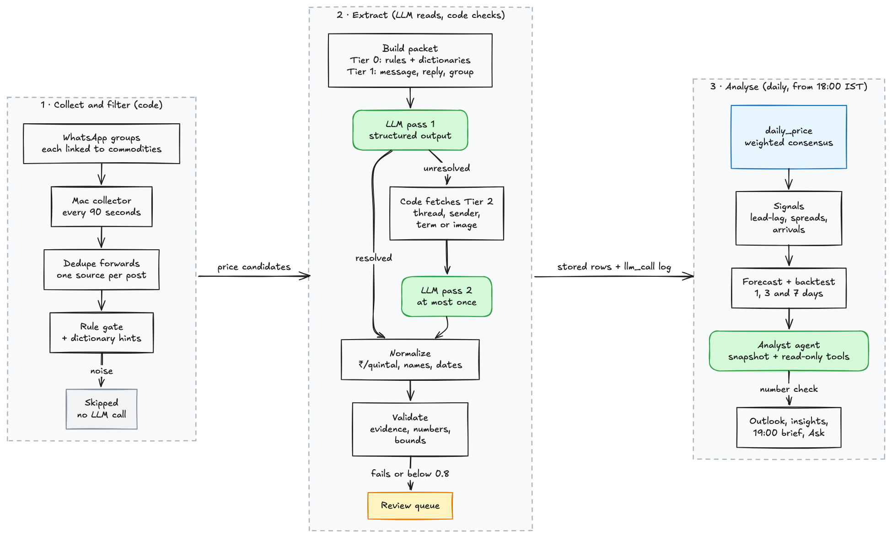

# Insider

**WhatsApp market intelligence for commodity buyers.** Insider reads the trader WhatsApp groups you already follow, turns the messages into clean, comparable mandi prices, and writes a short evening brief on what moved today and where to buy.

> **Status: early development.** The scaffold is in place (collector, API, pipeline skeleton, web app, contracts, CI). The collector runs against a synthetic WhatsApp fixture, price extraction with an LLM is not wired up yet, and user login is a development bypass. See [Roadmap](#roadmap).

---

## Why

In Indian agri-commodity trade, prices for castor, groundnut and other crops arrive every day through many WhatsApp groups of traders, brokers and commission agents. That stream is useful, but hard to act on:

- **Too much, mostly noise.** Most messages are greetings, forwards and ads. The rate lists are buried among them.
- **No common format.** Prices arrive per 20 kg, per quintal or per kg. Commodities and mandis are named in Gujarati, Hindi or Gujlish (એરંડા / divela / castor). Many rate sheets are photos.
- **Hard to trust.** The same post gets forwarded across groups, rumours circulate, and one wrong number can drive a bad buying decision.
- **Lives on one phone.** What one person reads does not reach the rest of the team, and there is no history to compare against.

## What Insider does

| Output | What you get |
|---|---|
| **Daily brief (19:00 IST)** | The day's significant price moves, mandi spreads, arrival spikes, conflicting reports and top news, in one summary |
| **Price board** | Latest price per commodity × mandi, normalized to ₹/quintal, with the change vs yesterday and vs the 7-day average |
| **Trends and spreads** | Price history by market, market-to-market spreads, arrivals volumes |
| **Chats** | Every watched group as a WhatsApp-style chat, with the prices read from each message shown under it |
| **Review queue** | Low-confidence extractions checked by a person before they count |

The main question it answers: **"What moved today, and where should we buy?"**

### Why the numbers can be trusted

- Every price shows **how many independent sources and groups** reported it, and links back to the original messages.
- Forwards of the same post are **de-duplicated** and count as one source.
- Sanity checks reject impossible values (min > max, future dates, a price more than ±40% away from the 30-day median). Anything uncertain goes to human review, not the price tables.
- Conflicting reports become an insight of their own instead of being averaged away.

### Principles

- **Read-only.** Insider never sends messages and never talks to WhatsApp's servers. It reads the Mac's local copy of messages already received.
- **Privacy by default.** Sender phone numbers are HMAC-hashed on the Mac before upload. Before message text reaches an LLM (`/v1/ask`, the analyst CLI), phone numbers and @mentions are masked.
- **Server-side analysis.** The pipeline runs on the server, so the data survives the laptop and everyone sees the same numbers. The UI is mobile-first because the brief gets read in the field.
- **Bilingual.** Gujarati and English labels from day one.
- **Configurable scope.** It starts with castor and groundnut. More commodities and mandis are added through dictionaries, without code changes.

---

## How it works

```
 WhatsApp Desktop (Mac)          Backend                                  Users
┌──────────────────────┐   ┌────────────────────────────────────┐   ┌───────────────┐
│ Insider Collector    │──▶│ Hono ingest API ─▶ BullMQ pipeline │──▶│ SvelteKit web │
│ (Electron menu-bar)  │   │  dedupe → classify → extract →     │   │ app (phone +  │
│ reads local SQLite   │   │  normalize → validate → store      │   │ desktop)      │
│ copy, outbox upload  │──▶│ GCS (images, PDFs)  Postgres       │   │               │
└──────────────────────┘   └────────────────────────────────────┘   └───────────────┘
```

1. **Collect.** A menu-bar app on a Mac linked to WhatsApp copies the local message database every ~90 seconds. It reads new messages from the watched groups and uploads them through an offline-safe outbox.
2. **Process.** The server de-duplicates forwards, classifies each message (price, arrivals, news, advisory, noise) and extracts structured prices with an LLM (vision for rate-sheet images). It maps names and units to a canonical form and checks the result.
3. **Aggregate.** Jobs build daily prices per commodity × mandi, detect insights and write the evening brief.
4. **Read.** The web app shows the brief, prices, trends, chats and review queue.

### Market Analyst (planned)

How a message becomes a stored price, and how the daily analysis turns prices into forecasts and market-shift insights. Nothing in this diagram is built yet.



- **Green** steps call an LLM. Everything else is code. The LLM reads messages; it never sees computed prices and never calculates one.
- **Context tiers.** Tier 0 (rules and dictionaries, cached) and Tier 1 (the message, the message it replies to, and the group) go with every call. Tier 2 (recent thread, the sender's recent messages, close dictionary matches, or other rows from the same image) is fetched by code only when the first pass says what it is missing. A message gets at most two LLM calls.
- **Yellow** is the human review queue: rows that fail a check or score below 0.8 confidence.

Edit the diagram: open [`docs/diagrams/market-analyst-architecture.excalidraw`](docs/diagrams/market-analyst-architecture.excalidraw) at [excalidraw.com](https://excalidraw.com) (File → Open). The mermaid source is [`market-analyst-architecture.mmd`](docs/diagrams/market-analyst-architecture.mmd). Test and eval cases: [docs/market-analyst-use-cases.md](docs/market-analyst-use-cases.md).

---

## Repository layout (monorepo, TypeScript only)

```
insider/
  apps/
    collector/         Electron menu-bar app (node:sqlite)
    web/               SvelteKit SPA + the "Mandi Ledger" design system (/design style guide)
  services/
    api/               Hono API + BullMQ worker; Drizzle owns the schema (Postgres schema market_intel)
  packages/
    contracts/         OpenAPI spec (source of truth) + generated TypeScript types
    fixtures/          synthetic WhatsApp database for development and tests
  tools/
    spike/             probe of a copy of the WhatsApp database
    export-importer/   backfill from WhatsApp .txt chat exports
    analyst/           analyst CLI (Claude Agent SDK, read-only)
  infra/               GCS bucket script, systemd units, Nginx config
  bin/insider          Mac command: start one service, or everything in dev mode
  compose.yaml         local dev containers (Postgres, Redis, API, worker, web); docker/ holds the image
  docs/                plans and runbooks
```

One language (TypeScript), one package manager (pnpm workspaces), one lockfile.

### Stack

| Component | Tech | Suggested hosting |
|---|---|---|
| Collector | Electron 38, TypeScript, `node:sqlite` | A Mac signed in to WhatsApp Desktop |
| Schema | Drizzle ORM + drizzle-kit migrations, Postgres schema `market_intel` | Any Postgres (e.g. Supabase) |
| API | Hono on Node 22, request validation compiled from the OpenAPI spec | Linux VM behind Nginx |
| Pipeline | BullMQ + Redis (inline mode without Redis), LLM structured output (Gemini; Claude optional) | Same VM, worker process |
| Agents | `/v1/ask` on the Anthropic SDK Tool Runner; analyst CLI on the Claude Agent SDK (`tools/analyst`) | API VM (Ask); local machine (analyst) |
| Media | Google Cloud Storage, signed URLs | Any GCS region |
| Web | SvelteKit (Svelte 5), Tailwind 4, TanStack Query, ECharts | Any static host (e.g. Firebase Hosting) |

---

## Run it locally (macOS)

Everything except the collector runs in Docker: Postgres, Redis, migrations, the API, the job worker and the web app ([compose.yaml](compose.yaml)). The database lives in the `insider_pgdata` Docker volume.

Prerequisites: [Docker Desktop](https://docs.docker.com/desktop/setup/install/mac-install/), and Node 22 + pnpm on the Mac for the collector, tests, type checks and codegen.

```bash
bin/insider setup
```

```bash
bin/insider dev
```

`bin/insider setup` copies [.env.example](.env.example) to `.env`. `bin/insider dev` builds the dev image if needed, starts the containers (Postgres :54329, Redis :6380, migrations, the API :8000, the job worker, the web app :5173), waits until the API is healthy, and then starts the collector on the Mac against the synthetic WhatsApp fixture. Source folders are mounted into the containers, so the API and the web app reload on save. Ctrl-C stops all of it. Ports bind to 127.0.0.1 only.

Other commands:

| Command | What it does |
|---|---|
| `bin/insider up` / `down` | Start the containers in the background / stop them |
| `bin/insider logs` | Follow the container logs |
| `bin/insider psql` | Open a database shell |
| `bin/insider create-device <name>` | Register a collector and print its device token |
| `bin/insider <db\|redis\|migrate\|seed\|api\|worker\|web\|collector>` | Start one service on its own |
| `bin/insider test` | Run every test suite (on the Mac) |
| `bin/insider help` | Full list |

The same commands are Make targets (`make setup`, `make dev`, `make web`, …; `make help` lists them). Two exist only in Make:

- `make dev-web` starts the containers without the collector.
- `make dev-real` (or `make collector-real` for the collector alone) reads the Mac's real WhatsApp Desktop database instead of the fixture. The collector runs as its own app, `.dev/Insider Collector.app`; turn on Full Disk Access for **Insider Collector** (not the terminal). Set `WA_REAL_DB=<path>` to use another copy.

---

## Roadmap

| Phase | Outcome | Status |
|---|---|---|
| 0. Spike | Prove the WhatsApp database is readable; extraction prototype ≥80% accurate | In progress |
| 1. Scaffold | Monorepo, contracts, schema, API, web shell, collector core, CI | Done |
| 2. Ingestion | Live messages in the web feed within 3 minutes; no loss when offline | In progress |
| 3. Extraction | Structured prices at ≥90% precision; review queue | Not started |
| 4. Insights | Price board, trends, daily brief every evening; natural-language Q&A | Agent scaffold done |
| 5. Hardening | Real login, alerts, signed collector, runbook; a week unattended with no gaps | Not started |

Full plan: [docs/scaffolding-plan.md](docs/scaffolding-plan.md).

## Known risks

- **WhatsApp encrypts or changes its local database.** The collector checks the schema fingerprint and alerts on any change. The reader module can be swapped for a fallback collector.
- **Mac asleep or away.** The outbox catches up on wake.
- **Poor-quality rate-sheet images and rumours.** Vision extraction, human review, source counts and conflict detection.

---

## Responsible use

Insider is an independent project. It is **not affiliated with, endorsed by or supported by WhatsApp or Meta**.

It reads the local message database of a WhatsApp Desktop installation that you control. If you run it, you are responsible for:

- having the right to process the messages of the groups you watch, including telling group members where that is expected;
- complying with WhatsApp's Terms of Service and the data-protection law that applies to you (for example India's DPDP Act or the GDPR);
- keeping the collected data secure and not reselling it.

Do not run it on groups or devices you do not own or administer.

## Contributing

Issues and pull requests are welcome. Before you open a PR:

- run `bin/insider test` and the type checks (`pnpm check`);
- if you change an API, edit [packages/contracts/openapi.yaml](packages/contracts/openapi.yaml) first and regenerate the types (CI fails on drift);
- never commit real WhatsApp data, chat exports, phone numbers or `.env` files. Use the synthetic fixture in [packages/fixtures](packages/fixtures).

## License

[GNU Affero General Public License v3.0](LICENSE). If you run a modified version as a network service, you must make your source changes available to its users.
